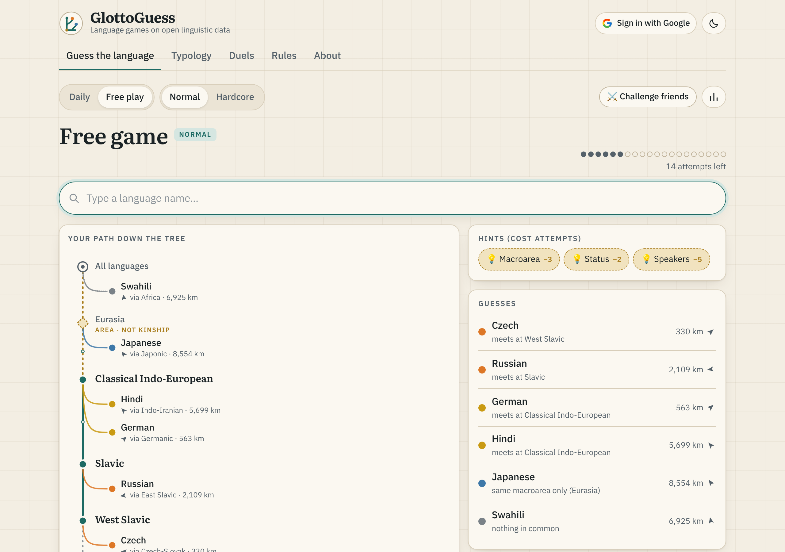
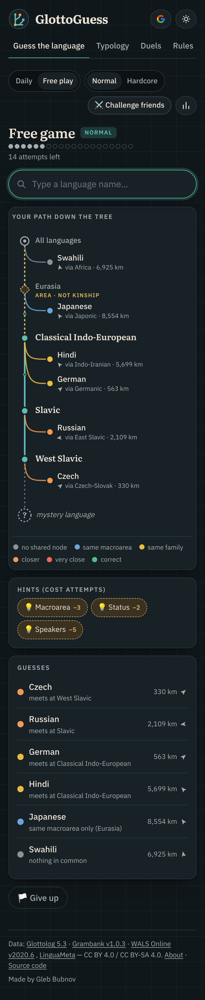
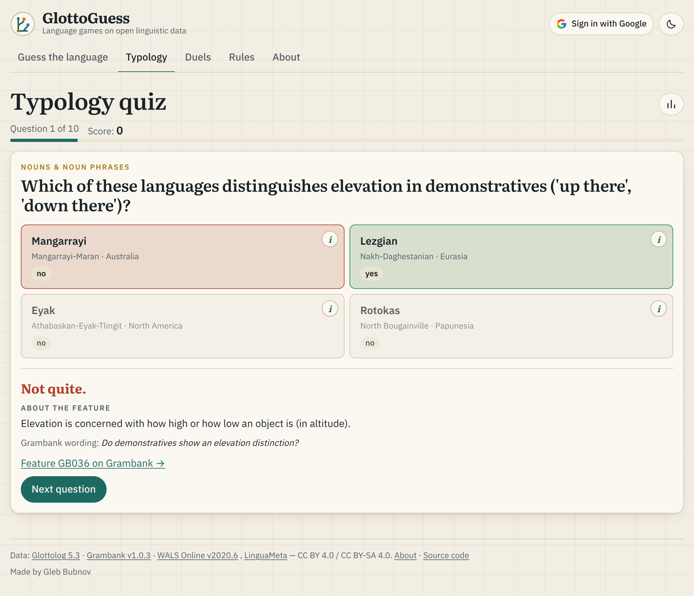
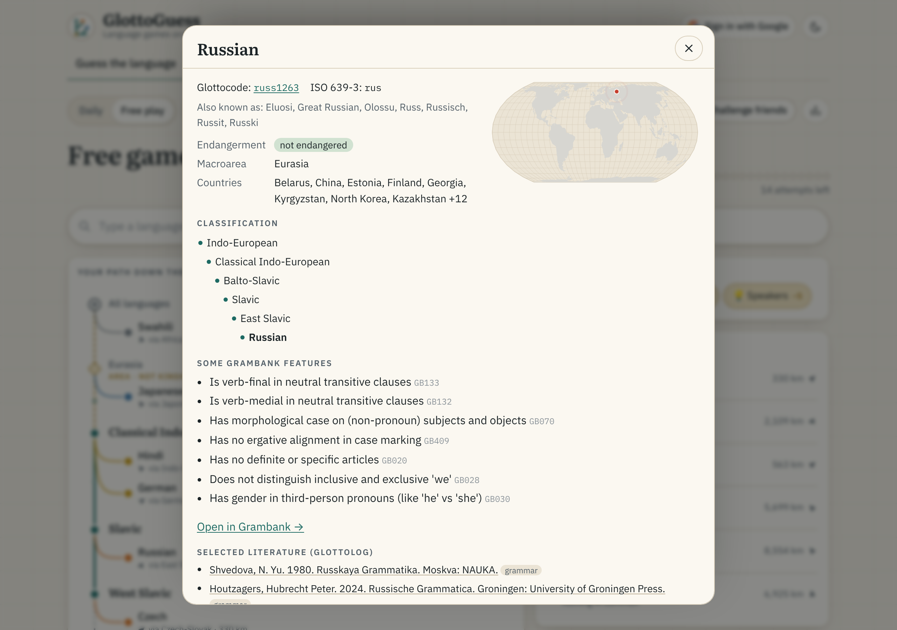
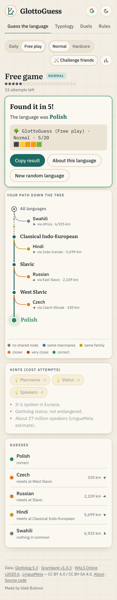
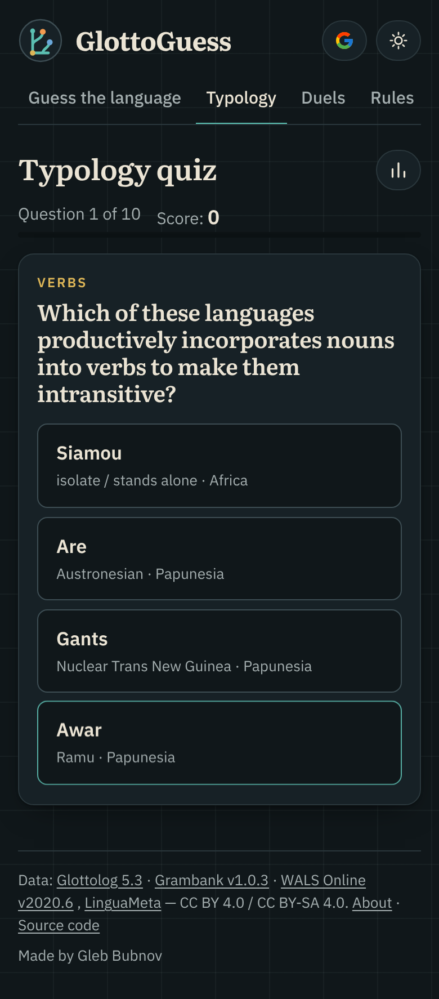

# GlottoGuess

**Language games on open linguistic data** · by Gleb Bubnov · [Русская версия ниже](#glottoguess-по-русски)

Live: https://interprole.github.io/glottoguess/ (after the first deploy from `main`)

| Guess the language (desktop) | Mobile, dark theme | Typology quiz |
|---|---|---|
|  |  |  |

| Language card | Solved puzzle | Hard typology, dark |
|---|---|---|
|  |  |  |

## The games

**Guess the language**: a daily genealogical puzzle in the style of Metazooa.
- Every guess reveals the lowest node of the Glottolog classification that it shares with the mystery language, and the tree grows with each guess.
- A non-genealogical macroarea level sits above the families, drawn dashed and labelled "area · not kinship".
- Each guess also shows the distance and direction to the target.
- You get 20 attempts.
- Hints cost attempts: macroarea −3, Glottolog endangerment status −2, number of speakers −5. Speaker numbers come from LinguaMeta. When LinguaMeta has no estimate, the hint still costs 5 and says so.
- **Give up** reveals the answer and counts as a loss.
- Modes: a daily puzzle (same for everyone, changing at 00:00 UTC) and free play, each with Normal and Hardcore pools.
- Results can be shared as a spoiler-free emoji grid.

**Typology**: a 10-question quiz on Grambank features.
- Each question shows four languages, and exactly one of them has the feature.
- A question is asked only if the value is known for all four languages; "?" never counts as "no".
- On **easy**, the languages are well known and come from different families and areas.
- On **hard**, the distractors have the most similar Grambank profiles but differ on the asked feature. Profiles are compared only on features known in both languages, with at least 50 shared.
- You can filter by topic.

**Accounts and duels**:
- Signing in with Google is optional. It syncs your statistics for both games across devices through Firebase.
- Signed-in players can **challenge friends**: a duel link gives everyone the same mystery language, or the same ten typology questions.
- Everyone plays whenever they like. Players who have finished, plus the duel's creator, see the leaderboard.

### How does a daily puzzle work on a static site?

There is no server choosing the language. Every browser computes it, and all browsers get the same answer:

1. Take today's day number in UTC.
2. Take the sorted pool of target languages (Normal or Hardcore).
3. Shuffle the pool with a pseudo-random generator seeded with a fixed string plus the cycle number.
4. Day *n* gets item *n mod N*.

Because the inputs (the date and the data files) are identical everywhere, the result is identical everywhere. No language repeats within a cycle of *N* days (465 for Normal, 7,489 for Hardcore). See `src/lib/daily.ts`.

## Data

| Dataset | Version used | License |
|---|---|---|
| Glottolog CLDF | [`glottolog/glottolog-cldf` v5.3](https://github.com/glottolog/glottolog-cldf/releases/tag/v5.3) | CC BY 4.0 |
| Grambank CLDF | [`grambank/grambank` v1.0.3](https://github.com/grambank/grambank/releases/tag/v1.0.3) | CC BY 4.0 |
| WALS CLDF | [`cldf-datasets/wals` v2020.6](https://github.com/cldf-datasets/wals/releases/tag/v2020.6) | CC BY 4.0 |
| LinguaMeta (speaker numbers) | [`google-research/url-nlp` @452a21a](https://github.com/google-research/url-nlp/tree/452a21ad3dae5668c06ceeac21ff073e1e40f9be/linguameta) (no releases; pinned commit) | CC BY-SA 4.0 |

Please cite:

- Hammarström, Harald & Forkel, Robert & Haspelmath, Martin & Bank, Sebastian. 2026. *Glottolog 5.3*. Leipzig: Max Planck Institute for Evolutionary Anthropology. https://glottolog.org
- Skirgård, Hedvig et al. 2023. Grambank reveals the importance of genealogical constraints on linguistic diversity and highlights the impact of language loss. *Science Advances* 9(16): eadg6175. https://doi.org/10.1126/sciadv.adg6175 (full author list on the site's About page)
- Dryer, Matthew S. & Haspelmath, Martin (eds.) 2013. *The World Atlas of Language Structures Online*. Leipzig: Max Planck Institute for Evolutionary Anthropology. https://wals.info
- Ritchie, Sandy et al. 2024. LinguaMeta: Unified metadata for thousands of languages. *Proceedings of LREC-COLING 2024*, 10530–10538. https://aclanthology.org/2024.lrec-main.921

The raw data are **not** committed. Only compact derived files are in `public/data/` (~3 MB gzipped, most of it the
lazily loaded bibliography). The speaker numbers in `public/data/core.json` are derived from LinguaMeta and are
therefore under CC BY-SA 4.0.

## Firebase setup (sign-in, sync, duels)

The web config is in `src/firebase-config.ts`. These keys are public by design; access is controlled by the Firestore rules. One-time setup in the [Firebase console](https://console.firebase.google.com/project/glottoguess):

1. **Authentication → Sign-in method → Google → Enable.**
2. **Authentication → Settings → Authorized domains → Add domain** `interprole.github.io`. Add `localhost` too for local testing; it is there by default.
3. **Firestore Database → Create database** (production mode).
4. **Firestore Database → Rules**: paste the contents of [`firestore.rules`](firestore.rules) and click **Publish**.

Data model:
- `users/{uid}`: `{ progress, name, updatedAt }`. Progress is a history of results (daily puzzles by day, typology series by id, duel ids), so copies from several devices merge without double counting.
- `duels/{id}`: `{ creatorUid, creatorName, createdAt, spec }`. `spec` is either the guess difficulty plus the lightly obfuscated target, or the typology difficulty, topic and seed.
- `duels/{id}/results/{uid}`: one result per player. It is write-once and readable only by the creator and by players who have finished.

## Development

```bash
# data (Python ≥ 3.10, standard library only; pytest for tests)
python scripts/fetch_data.py      # shallow-clones the pinned versions into raw/
python scripts/build_data.py      # writes public/data/*.json and prints statistics
python -m pytest tests

# site
npm ci
npm run dev                       # http://localhost:5173/glottoguess/
npm test                          # Vitest
npm run build                     # typecheck + production build into dist/
```

**Updating the data:** bump the versions in `scripts/datasets.json`, re-run both scripts and commit `public/data`.

**Feature wordings:** plain-language wordings of Grambank features live in **`data/feature_texts.json`**, next to the original Grambank wording. Edit them there and rebuild.

**Layout:**
- `scripts/`: the data pipeline
- `tests/`: the pytest suite
- `src/lib/`: pure game logic, with `*.test.ts` alongside
- `src/components/`: the UI (Preact)
- `src/lib/cloud.ts`: the Firebase layer, loaded lazily

**CI and deploy:** CI runs both test suites and the build on every push. `deploy.yml` publishes `main` to GitHub Pages (Settings → Pages → Source: *GitHub Actions*).

---

## GlottoGuess по-русски

Лингвистические игры на открытых данных. Автор — Глеб Бубнов. Интерфейс сайта на английском, есть светлая и тёмная темы.

**«Guess the language»** — ежедневная генеалогическая загадка в духе Metazooa.
- После каждой догадки показывается самый нижний общий узел классификации Glottolog с загаданным языком, и дерево достраивается.
- Над семьями есть уровень макроареалов: он нарисован пунктиром, это не родство.
- Для каждой догадки показаны расстояние и направление до загаданного языка.
- Даётся 20 попыток.
- Подсказки стоят попыток: макроареал −3, статус угрозы −2, число носителей −5. Число носителей берётся из LinguaMeta; если данных нет, подсказка всё равно стоит 5 и сообщает об этом.
- «Give up» сдаётся и раскрывает ответ, это считается поражением.

**«Typology»** — 10 вопросов по признакам Grambank: признак есть ровно у одного из четырёх языков.

**Вход через Google** необязателен. Он нужен, чтобы статистика синхронизировалась между устройствами, и для **дуэлей**:
- по ссылке все играют в одну и ту же игру, когда им удобно;
- результаты видят те, кто уже закончил, и создатель дуэли.

**Как ежедневная загадка работает на статическом сайте?** Сервер не нужен: каждый браузер сам вычисляет ответ.
1. Берётся номер текущего дня по UTC.
2. Берётся отсортированный пул языков.
3. Пул перемешивается генератором псевдослучайных чисел с фиксированным зерном.
4. День *n* получает *n*-й элемент.

Входные данные у всех одинаковые, поэтому и язык у всех одинаковый.

**Данные:** Glottolog 5.3, Grambank v1.0.3, WALS v2020.6 (CC BY 4.0), LinguaMeta (CC BY-SA 4.0). Цитирование — выше и на странице «About».
