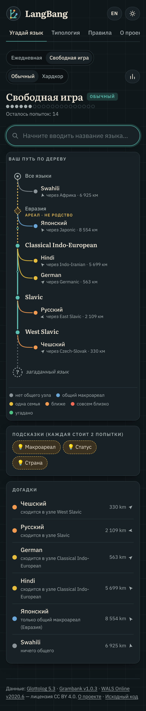

# LangBang

**Language games on open linguistic data** · [Русская версия ниже](#langbang-по-русски)

Live: https://interprole.github.io/langbang/ (after the first deploy from `main`)

| Guess the language (desktop) | Mobile, dark, Russian UI | Typology quiz |
|---|---|---|
|  |  |  |

| Language card | Solved puzzle | Hard typology, dark |
|---|---|---|
|  |  |  |

## The games

**Guess the language**: a daily genealogical puzzle in the style of Metazooa. Every guess reveals the lowest node of
the Glottolog classification that it shares with the mystery language. The tree grows with each guess. A
non-genealogical macroarea level (dashed, labelled "area · not kinship") sits above the families. Each guess
also shows the distance and direction to the target. You get 20 attempts, and hints cost 2 attempts each. The game
has a daily puzzle (same for everyone, changing at 00:00 UTC) and free play, Normal and Hardcore pools, spoiler-free
emoji sharing, and local statistics.

**Typology**: a 10-question quiz on Grambank features. Each question shows four languages, exactly one of which has
the feature. Values must be known for all four ("?" never counts as "no"). On **easy**, the languages are well known
and come from different families and areas. On **hard**, the distractors have the most similar Grambank profiles
(compared only on features known in both languages, ≥ 50 shared) but differ on the asked feature. You can filter
by topic.

## Data

| Dataset | Release used | License |
|---|---|---|
| Glottolog CLDF | [`glottolog/glottolog-cldf` v5.3](https://github.com/glottolog/glottolog-cldf/releases/tag/v5.3) | CC BY 4.0 |
| Grambank CLDF | [`grambank/grambank` v1.0.3](https://github.com/grambank/grambank/releases/tag/v1.0.3) | CC BY 4.0 |
| WALS CLDF | [`cldf-datasets/wals` v2020.6](https://github.com/cldf-datasets/wals/releases/tag/v2020.6) | CC BY 4.0 |

Please cite:

- Hammarström, Harald & Forkel, Robert & Haspelmath, Martin & Bank, Sebastian. 2026. *Glottolog 5.3*. Leipzig: Max Planck Institute for Evolutionary Anthropology. https://glottolog.org
- Skirgård, Hedvig et al. 2023. Grambank reveals the importance of genealogical constraints on linguistic diversity and highlights the impact of language loss. *Science Advances* 9(16): eadg6175. https://doi.org/10.1126/sciadv.adg6175 (full author list on the site's About page)
- Dryer, Matthew S. & Haspelmath, Martin (eds.) 2013. *The World Atlas of Language Structures Online*. Leipzig: Max Planck Institute for Evolutionary Anthropology. https://wals.info

The raw data are **not** committed. Only compact derived files are in `public/data/` (~2 MB gzipped, most of it the
lazily loaded bibliography).

## Development

```bash
# data (Python ≥ 3.10, standard library only; pytest for tests)
python scripts/fetch_data.py      # shallow-clones the pinned release tags into raw/
python scripts/build_data.py      # writes public/data/*.json and prints statistics
python -m pytest tests

# site
npm ci
npm run dev                       # http://localhost:5173/langbang/
npm test                          # Vitest
npm run build                     # typecheck + production build into dist/
```

To update the data, bump the tags in `scripts/datasets.json`, re-run both scripts and commit `public/data`.
Plain-language feature wordings live in **`data/feature_texts.json`**, next to the original Grambank wording. Edit
them there and rebuild.

Layout: `scripts/` holds the pipeline, `tests/` the pytest suite, `src/lib/` the pure game logic (with `*.test.ts`),
and `src/components/` the UI (Preact). CI runs both test suites and the build on every push. `deploy.yml` publishes
`main` to GitHub Pages (Settings → Pages → Source: *GitHub Actions*).

---

## LangBang по-русски

Лингвистические игры на открытых данных. Интерфейс на английском и русском (переключатель EN/RU), светлая и тёмная темы.

**«Угадай язык»** — ежедневная генеалогическая загадка, как Metazooa. После каждой догадки показывается самый нижний
общий узел классификации Glottolog с загаданным языком, и дерево достраивается. Над семьями есть уровень макроареалов:
он нарисован пунктиром с подписью «ареал · не родство». Для каждой догадки показаны расстояние и направление до
загаданного языка. Даётся 20 попыток, каждая подсказка стоит 2 попытки. Загадка меняется в 00:00 UTC и одинакова для
всех. Есть свободная игра, уровни «Обычный» и «Хардкор», шеринг без спойлеров и статистика в браузере.

**«Типология»** — 10 вопросов по признакам Grambank: признак есть ровно у одного из четырёх языков. Пропуски и «?»
никогда не считаются за «нет». Есть лёгкий и сложный уровни и фильтр по темам.

Данные: Glottolog 5.3, Grambank v1.0.3, WALS v2020.6 (CC BY 4.0). Цитирование — выше и на странице «О проекте».
Человеческие формулировки признаков (англ./рус.) лежат в `data/feature_texts.json`, рядом с исходными
формулировками Grambank, для ручной проверки.

Запуск: `python scripts/fetch_data.py && python scripts/build_data.py`, затем `npm ci && npm run dev`.
Тесты: `python -m pytest tests` и `npm test`.
